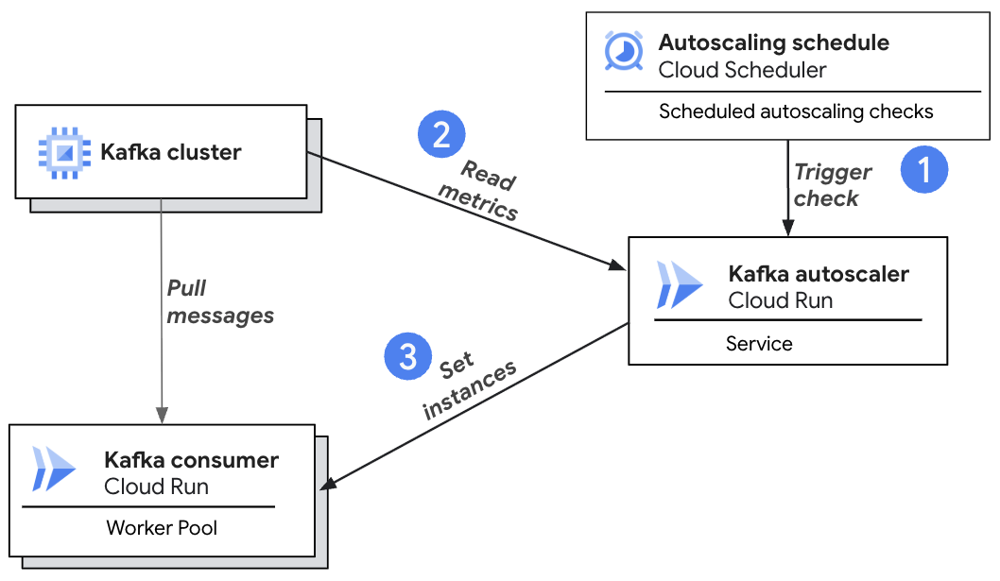

# Cloud Run Kafka Autoscaler


> [!WARNING]
>
> **This project is no longer actively developed or maintained.**
>
> Please check out [cloud-run-external-metrics-autoscaling](https://github.com/GoogleCloudPlatform/cloud-run-external-metrics-autoscaling) if you'd like to scale your Kafka consumers running on GCP Cloud Run.

This repository contains the source code for a buildable container image of an
autoscaler that horizontally autoscales Kafka consumers, running on Cloud Run,
based on consumer lag and CPU utilization. The autoscaler reads metrics from
your Kafka cluster, and uses [manual
scaling](https://cloud.google.com/run/docs/configuring/services/manual-scaling)
to scale a Kafka consumer workload based on the Kafka consumer lag metric.

**Please send any questions or feedback related to this autoscaler to run-oss-autoscaler-feedback@google.com**.

This autoscaler can be used with consumers running on Cloud Run services or the
new worker pools resource (in Public Preview).

## Architecture

The following diagram provides a visual overview of the system's architecture



Here’s how it works:

1.  **Scheduled Trigger:** A Cloud Scheduler job is configured to periodically
    trigger the autoscaling logic at a defined interval (e.g., every minute).
    For scaling checks more frequent than once per minute, the scheduler can be
    configured to push a task to a Cloud Tasks queue.
2.  **Read Kafka Lag:** The trigger invokes the Kafka Autoscaler Cloud Run
    service. The autoscaler connects directly to your Kafka cluster to read the
    consumer offset lag for your specified consumer group. It can also
    optionally fetch CPU utilization metrics for the consumer from Cloud Monitoring.
3.  **Set instances:** Based on the collected metrics and the user-defined
    scaling policies in the scaler_config.yaml secret, the autoscaler calculates
    the optimal number of consumer instances required to handle the current
    load. It then uses the Cloud Run Admin API's
    [manual scaling](https://cloud.google.com/run/docs/configuring/services/manual-scaling)
    feature to adjust the instance count of the target Kafka consumer workload
    (which can be a Cloud Run service or a worker pool).

## Building the Kafka Autoscaler
A container image of Kafka Autoscaler can be built from this source code using
Cloud Build.

Update the included `cloudbuild.yaml` to specify the output image name by
updating `%ARTIFACT_REGISTRY_IMAGE%`. Example:
`us-central1-docker.pkg.dev/my-project/my-repo/my_kafka_autoscaler`

```bash
gcloud builds submit --tag \
  us-central1-docker.pkg.dev/my-project/my-repo/my_kafka_autoscaler
```

This will build the container image and push it to Artifact Registry. Record
the full **Image Path** (`SCALER_IMAGE_PATH`), since we'll need it for later

Note that the resulting image will not run locally. It is intended to be
layered on top of a Java base image. See [Automatic base image updates](https://cloud.google.com/run/docs/configuring/services/automatic-base-image-updates)
for more information including how to reassemble the container image to run
locally.

## Setting up and Deploying the Autoscaler

You can set up the necessary Google Cloud components and deploy the Kafka
Autoscaler service using one of two methods:

1.  **Manual Setup:** Using the `gcloud` CLI commands and the provided shell
    script (`setup_kafka_scaler.sh`). This gives you fine-grained control over
    each step.
2.  **Automated Setup (Terraform):** Using the provided Terraform module
    (`terraform/`) to automate the creation of all required resources.

Before deploying the autoscaler using either the manual or Terraform method,
ensure the following prerequisites are met:

### Prerequisites

#### 1. Kafka Cluster

* A Kafka cluster must be running and accessible (e.g., via VPC or Managed
  Kafka).
*   A [Kafka Topic](https://kafka.apache.org/documentation/#basic_ops_add_topic)
    must be configured, with events that are being published to that topic.
*   Your Kafka consumers should specify a [Consumer Group
    ID](https://kafka.apache.org/documentation/#consumerconfigs_group.id) when
    connecting to the cluster.


#### 2. Deployed Cloud Run Consumer
* A Kafka consumer workload must be deployed to Cloud Run (as a service or
  worker pool) and configured to connect to your Kafka cluster and topic/
  consumer group.
* Identify the **Service Account email** used by this consumer workload
  (`CONSUMER_SA_EMAIL`). This service account needs permissions to interact
  with Kafka (e.g., read offsets).
*   **(Best Practice)** Connect your Kafka consumers to your VPC network using [Direct
    VPC](https://cloud.google.com/run/docs/configuring/vpc-direct-vpc). This
    allows you to connect to your Kafka cluster using private IP addresses, and
    keep traffic on your VPC network.
*   **(Best Practice)** Configure a [liveness healthcheck](https://cloud.google.com/run/docs/configuring/worker-pools/healthchecks)
    for your Kafka consumers that checks the Consumer is pulling events. This
    ensures unhealthy instances automatically restart if they stop processing
    events, even if the container doesn't crash.

#### 3. Required Roles

To get the permissions that you need to deploy and run this service, ask your
administrator to grant you the following IAM roles:

*   [Cloud Run Developer](https://cloud.google.com/iam/docs/understanding-roles#run.developer)
    (`roles/run.developer`)
*   [Service Account User](https://cloud.google.com/iam/docs/understanding-roles#iam.serviceAccountUser)
    (`roles/iam.serviceAccountUser`)
*   [Artifact Registry Reader](https://cloud.google.com/iam/docs/understanding-roles#artifactregistry.reader)
    (`roles/artifactregistry.reader`) to access the Scaler image
*   [Cloud Scheduler Admin](https://cloud.google.com/iam/docs/understanding-roles#cloudscheduler.admin)
(`roles/cloudscheduler.admin`) to create the Cloud Scheduler job to trigger
    autoscaling checks
*   [Cloud Tasks Queue Admin](https://cloud.google.com/iam/docs/understanding-roles#cloudtasks.queueAdmin)
(`roles/cloudtasks.queueAdmin`) to create the Cloud Tasks queue for autoscaling
    checks
*   [Security Admin](https://cloud.google.com/iam/docs/understanding-roles#iam.securityAdmin)
(`roles/iam.securityAdmin`) to grant permissions to service accounts

#### 4. Create Required Secrets

The autoscaler requires two secrets containing configuration:

##### a) Kafka Admin Client Secret (`ADMIN_CLIENT_SECRET`)
The Kafka autoscaler connects to the Kafka cluster using the configuration
provided in a secret that will be mounted as a volume on the Kafka autoscaler
service.

At a minimum, the `bootstrap.servers` property must be configured with the
bootstrap servers as a list of `HOST:PORT`.

```
bootstrap.servers=%BOOTSTRAP-SERVER-LIST%
```

This secret can contain any of the [Kafka Admin
client](https://kafka.apache.org/documentation/#adminclientconfigs)
properties. For example, to connect to a Google [Managed Service for Apache
Kafka](https://github.com/googleapis/managedkafka?tab=readme-ov-file#kafka-java-auth-client-handler)
 cluster using [application default
credentials](https://cloud.google.com/authentication/provide-credentials-adc)
with Google OAuth, this secret should include the following properties,
substituting the `%BOOTSTRAP-SERVER-LIST%` placeholder with the `HOST:PORT`
list:

```
bootstrap.servers=%BOOTSTRAP-SERVER-LIST%
security.protocol=SASL_SSL
sasl.mechanism=OAUTHBEARER
sasl.login.callback.handler.class=com.google.cloud.hosted.kafka.auth.GcpLoginCallbackHandler
sasl.jaas.config=org.apache.kafka.common.security.oauthbearer.OAuthBearerLoginModule required;
```

To create the secret volume, copy the configuration into a file named
`kafka_auth_config.txt`. From the same directory containing the file, run:

```bash
gcloud secrets create $ADMIN_CLIENT_SECRET --data-file=kafka_auth_config.txt
```

Note: If you are using Google Managed Service for Apache Kafka, you will need to
grant your scaler service account the role `roles/managedkafka.client`.

##### b) Scaler Configuration Secret (`SCALER_CONFIG_SECRET`)
The Kafka autoscaler uses the configuration provided in this secret to
specify the Kafka consumer to autoscale, as well as to adjust scaling
behavior. Like the Kafka Admin client secret, this will be mounted as a
volume on the Kafka autoscaler service.

Create a file `scaler_config.yaml` and copy the configuration below,
substituting the following placeholders:

*   `%FULLY_QUALIFIED_CONSUMER_NAME%` - The Kafka consumer workload to be
    autoscaled. (Format:
    *projects/`$PROJECT_ID`/locations/`$REGION`/`[workerpools|services]`/`$CONSUMER_SERVICE_NAME`*)
*   `%TARGET_CPU_UTILIZATION%` - Target CPU utilization for autoscaling
    calculations (e.g. 60)
*   `%LAG_THRESHOLD%` - Threshold for the `consumer_lag` metric to trigger (e.g.
    1000) autoscaling

You may also change any of the settings under `behavior`, as desired, or you may
leave the defaults. This section supports many of the same properties as
Kubernetes [HPA scaling
policies](https://kubernetes.io/docs/tasks/run-application/horizontal-pod-autoscale/#scaling-policies).

The following elements must be configured for the Kafka autoscaler to function:

```yaml
spec:
  scaleTargetRef:
    name: %FULLY_QUALIFIED_CONSUMER_NAME%
  metrics:
    - type: Resource
      resource:
        name: cpu
        target:
          type: Utilization
          averageUtilization: %TARGET_CPU_UTILIZATION%
    - type: External
      external:
        metric:
          name: consumer_lag
        target:
          type: AverageValue
          averageValue: %LAG_THRESHOLD%
```
Note: While you may choose to configure `consumer_lag` only, we recommend
starting with both `consumer_lag` and `cpu`, as just using `consumer_lag` can
have unexpected results.

See [Reference](#optional-metric-configuration-options) for additional
configurable fields.

###### Create the secret

To create the secret, from the same directory containing the
`scaler_config.yaml` file, run:

```bash
gcloud secrets create $SCALER_CONFIG_SECRET --data-file=scaler_config.yaml
```

## Deployment Options

With the prerequisites completed, as mentioned earlier, you can deploy the
Kafka Autoscaler service and its supporting infrastructure using one of the
following methods:

1.  **Manual Deployment:** Using `gcloud` CLI commands and the provided shell
    script.
2.  **Automated Deployment (Terraform):** Using the provided Terraform module.

Choose the method that best suits your workflow.

### Option 1: Manual Deployment (`gcloud` / Shell Script)

This approach uses the `setup_kafka_scaler.sh` script to create and
configure the necessary resources.

#### Set Environment Variables

Set the following variables which are used by the setup script.

```bash
# GCP Project ID
export PROJECT_ID=<project-id>
# GCP Region
export REGION=<region>
# Fully qualified name of the deployed Cloud Run service or worker pool to scale
# Example: projects/my-project/locations/us-central1/workerpools/my-kafka-consumer
export CONSUMER_SERVICE_NAME=<deployed-kafka-consumer>
# Email of the Service Account used by the consumer workload. The setup script
# will grant the scaler service account permission to use consumer service
# account.
# Example: my-consumer-service-account@my-project.iam.gserviceaccount.com
export CONSUMER_SA_EMAIL=<kafka-consumer-service-account-email>
# Kafka consumer group ID to monitor
export CONSUMER_GROUP_ID=<kafka-consumer-group-id>

# Name for the scaler Cloud Run service to be created
export SCALER_SERVICE_NAME=<kafka-autoscaler-service-name>
# Full Artifact Registry path to the scaler image built in the previous step
# Example: us-central1-docker.pkg.dev/my-project/my-repo/my_kafka_autoscaler
export SCALER_IMAGE_PATH=<kafka-autoscaler-image-URI>
# Fully qualified name of the existing secret which contains scaling
# configuration
# Example: projects/my-project/secrets/scaler-config
export SCALER_CONFIG_SECRET=<kafka-autoscaler-config-secret-name>
# Fully qualified name of the existing secret which contains the Kafka Admin
# Client properties for communicating with your Kafka broker
# Example: projects/my-project/secrets/client-properties
export ADMIN_CLIENT_SECRET=<kafka-admin-client-secret-name>

# Frequency in seconds for autoscaling checks. We recommend 5+ seconds.
export CYCLE_SECONDS=<scaler-check-frequency e.g. 15>
# Name for the Cloud Tasks queue (required if CYCLE_SECONDS < 60)
export CLOUD_TASKS_QUEUE_NAME=<cloud-tasks-queue-for-scaling-checks>
# Name for the Service Account to be created for Cloud Tasks to invoke the scaler (required if CYCLE_SECONDS < 60)
export TASKS_SERVICE_ACCOUNT=<tasks-service-account-name>

# Optional: By default, this autoscaler will scale on the combined lag across
# all topics that the specified consumer group is subscribed to. You can
# optionally specify a single topic id which will cause your scaler to scale
# solely on the lag of specified topic.
export TOPIC_ID=<kafka-topic-id>

# Optional: Set to true to output scaler metrics to Cloud Monitoring.
# The scaler service account will need roles/monitoring.metricWriter.
export OUTPUT_SCALER_METRICS=false

# Optional: VPC Network name for the scaler service
export NETWORK=<vpc-network>

# Optional: VPC Subnet name for the scaler service
export SUBNET=<vpc-subnet>
```

#### Run the Setup Script

Execute the provided `setup_kafka_scaler.sh` script, as follows

```bash
./setup_kafka_scaler.sh
```

The script performs these actions:

*   If `CYCLE_SECONDS` < 60, creates the Cloud Tasks queue used to trigger
    autoscaling checks
*   Creates the Kafka autoscaler service account, and grants necessary
    permissions
*   Configures and deploys the Kafka autoscaler Cloud Run service
*   Creates the Cloud Scheduler job that periodically triggers autoscaling checks

When run, `setup_kafka_scaler.sh` will output the configured environment
variables. Please verify they are correct before continuing.

#### Grant Additional Permissions
In order to change the instance count of the Kafka consumer, the Kafka
autoscaler service account must have view permission on the deployed container
image. For example, if the consumer image was deployed from Artifact Registry,
please run:


```bash
gcloud projects add-iam-policy-binding $PROJECT_ID \
  --member="serviceAccount:$SCALER_SA_NAME@$PROJECT_ID.iam.gserviceaccount.com" \
  --role="roles/artifactregistry.reader" # Or appropriate role for your registry
```

### Option 2: Automated Deployment (Terraform)

The `terraform/` directory contains a reusable Terraform module to provision
the Kafka Autoscaler and its associated resources.

This module automates the creation of:

* The Kafka Autoscaler Cloud Run service
* Supporting Service Accounts and IAM bindings
* Cloud Tasks queue
* Cloud Scheduler job

For detailed instructions, usage examples, and descriptions of all input/output
variables, please refer to [**`terraform/README.md`**](terraform/README.md)

Remember to provide the necessary variables to the Terraform module, including
details from the prerequisites (project ID, region, consumer SA email, secret
names, scaler image path, topic ID, etc.).


## Verify Kafka Autoscaling is Working

The Kafka autoscaler service's scaling is triggered with a request to the
service URL.

*   `POST` requests will trigger the autoscaling calculation, output to logging,
    AND change the instance count based on the recommendation

In the logs of your Kafka autoscaler service, you should see messages like
*There are currently X consumers and Y total lag. Recommending Z consumers.*

If the OUTPUT_SCALER_METRICS flag is enabled, you can also find scaler Cloud
Monitoring metrics under `custom.googleapis.com/cloud-run-kafkascaler/`.

## Cost Considerations

This solution uses the following billable Google Cloud components:

* Cloud Run (Kafka consumer workload and the autoscaler service)
* Cloud Scheduler
* Cloud Tasks
* Secret Manager

The deployed Cloud Run resources are billed for the compute time used at the
standard [Cloud Run prices](https://cloud.google.com/run/pricing).

The autoscaler runs as a request-billed service with `max-instances=1`, so its
costs are minimal (typically less than $1 per month).

To stop all billing, you must delete the created resources. The `cleanup.sh`
script in the root of this repository can be used to delete the resources
created by the setup script. If you used Terraform to deploy the resources,
run `terraform destroy` to remove all associated infrastructure.

## Reference

### Optional Metric Configuration Options

In addition to the metric targets, you can optionally configure additional
elements to adjust scaling behavior. If not configured, the default values
are used.

*   `%CPU_ACTIVATION_THRESHOLD%` (default: 0) - Metric will be considered
    "inactive" when below this threshold. When all metrics are "inactive",
    target consumer will be scaled to zero.
*   `%CPU_TOLERANCE%` (default: 0.1) - Prevent scaling changes if within
    specified range (as a percent of the configured TARGET_CPU_UTILIZATION)
*   `%CPU_METRIC_WINDOW%` (default: 120) - Period, in seconds, over which the
    average CPU utilization is calculated
*   `%LAG_ACTIVATION_THRESHOLD%` (default: 0) - Metric will be considered
    "inactive" when below this threshold. When all metrics are "inactive",
    target consumer will be scaled to zero.
*   `%LAG_TOLERANCE%` (default: 0.1) - Prevent scaling changes if within
    specified range (as a percent of the configured LAG_THRESHOLD)

```yaml
spec:
  scaleTargetRef:
    name: %FULLY_QUALIFIED_CONSUMER_NAME%
  metrics:
    - type: Resource
      resource:
        name: cpu
        target:
          type: Utilization
          averageUtilization: %TARGET_CPU_UTILIZATION%
          activationThreshold: `%CPU_ACTIVATION_THRESHOLD%`
          tolerance: %CPU_TOLERANCE%`
          windowSeconds: `%CPU_METRIC_WINDOW%`
    - type: External
      external:
        metric:
          name: consumer_lag
        target:
          type: AverageValue
          averageValue: %LAG_THRESHOLD%
          activationThreshold: `%LAG_ACTIVATION_THRESHOLD%`
          tolerance: `%LAG_TOLERANCE%`
```

### Scaling Policy

Note: See [Kubernetes Horizontal Pod
Autoscaling](https://kubernetes.io/docs/reference/kubernetes-api/workload-resources/horizontal-pod-autoscaler-v2/#HorizontalPodAutoscalerSpec)
documentation for detailed explanation of each element.

```yaml
behavior:
  scaleDown:
    stabilizationWindowSeconds: [INT]
    policies:
    - type: [Percent, Instances]
      value: [INT]
      periodSeconds: [INT]
    selectPolicy: [Min, Max]
  scaleUp:
    stabilizationWindowSeconds: [INT]
    policies:
    - type: [Percent, Instances]
      value: [INT]
      periodSeconds: [INT]
    selectPolicy: [Min, Max]
```

*   `scaleDown`: Behavior when reducing instance count (scaling down)
*   `scaleUp`: Behavior when increasing instance count (scaling up)
*   `stabilizationWindowSeconds`: Uses the highest (scaleDown) or lowest
    (scaleUp) calculated instance count over a rolling period. Setting to 0
    means the latest calculated value is used.
*   `selectPolicy`: Which outcome to enforce when multiple policies are
    configured. Min: smallest change, Max: largest change
*   `Percent`: Changes per-period are limited to the configured percent of total
    instances
*   `Instances`: Changes per-period are limited to the configured number of
    instances
*   `periodSeconds`: Length of time over which the policy is enforced

If either the `scaleUp` or `scaleDown` policy is unspecified, the following
default default `scaleUp` and `scaleDown` policies will be used:

```yaml
behavior:
  scaleDown:
    stabilizationWindowSeconds: 300
    policies:
    - type: Percent
      value: 50
      periodSeconds: 30
    selectPolicy: Min
  scaleUp:
    stabilizationWindowSeconds: 0
    policies:
    - type: Percent
      value: 100
      periodSeconds: 15
    - type: Instances
      value: 4
      periodSeconds: 15
    selectPolicy: Max
```

### Full example config
```yaml
spec:
  scaleTargetRef:
    name: projects/PROJECT-ID/locations/us-central1/workerpools/kafka-consumer-worker
  metrics:
    - type: Resource
      resource:
        name: cpu
        target:
          type: Utilization
          averageUtilization: 60
          activationThreshold: 0
          tolerance: 0.1
          windowSeconds: 120
    - type: External
      external:
        metric:
          name: consumer_lag
        target:
          type: AverageValue
          averageValue: 1000
          activationThreshold: 0
          tolerance: 0.1
  behavior:
    scaleDown:
      stabilizationWindowSeconds: 300
      policies:
        - type: Percent
          value: 50
          periodSeconds: 30
      selectPolicy: Min
    scaleUp:
      stabilizationWindowSeconds: 0
      policies:
        - type: Percent
          value: 100
          periodSeconds: 15
        - type: Instances
          value: 4
          periodSeconds: 15
      selectPolicy: Max
```

## Troubleshooting

### OutOfMemoryError

If you're seeing `java.lang.OutOfMemoryError` on startup, verify that your
Kafka Admin Client Secret matches your broker's SSL configuration as the error
may be a red herring. See [KAFKA-4493](https://issues.apache.org/jira/browse/KAFKA-4493)
for details.

## FAQs
**Q: How do I decide whether to use services or worker pools for my Kafka Consumers?**

A: Kafka Autoscaler can be used to scale your Kafka Consumers running as either
Cloud Run services or worker pools, but we strongly recommend using worker
pools. They are purpose-built for non-HTTP, pull-based workloads and are 40%
cheaper than comparable instance-billed services. Also, with no HTTP endpoint,
worker pools reduce the attack surface and simplify application code.

If you already have existing Kafka consumers running as Cloud Run services, you
can still use the Kafka Autoscaler for queue-aware autoscaling with the same
configuration.